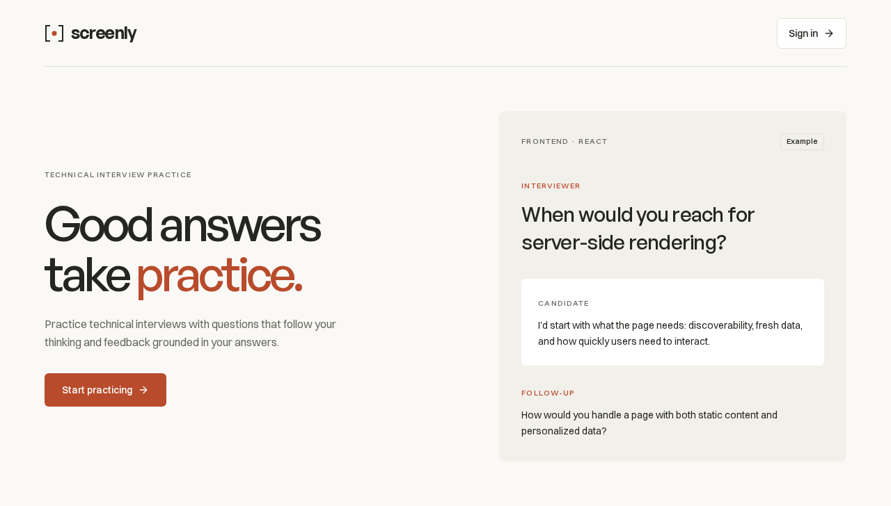

# Screenly · Technical interview practice

A technical interview practice app built for learning and portfolio use. Choose a role, experience level, topics, and duration; practice by speaking to the agent; then review your saved transcript and feedback scored out of 10.



## What works

- Warm-paper light workspace with fern actions, a fixed desktop sidebar, mobile navigation drawer, local Geist typography, and keyboard access.
- Centered voice stage tied to real session states and microphone input, concise live captions, optional inline transcript, and a mute/interrupt/finish dock.
- Google OAuth authentication through Better Auth.
- Frontend, backend, and full-stack interviews at three experience levels.
- Deepgram Flux transcription and speech, with streamed LLM replies through the OpenAI library.
- Adaptive follow-ups using session settings and conversation history.
- Microphone/speaker checks, mute, interruption, and replay.
- Saved conversations, structured feedback, searchable history, deletion, and transcript export.
- Session ownership checks, duplicate-answer protection, bounded provider waits, and recovery after disconnection.

## Requirements

Bun 1.3.5+ (verified with 1.4.3), Node.js 22+, and an OpenAI-compatible Chat Completions provider. Deepgram is required for microphone transcription and spoken replies. All interview answers are spoken through the microphone.

## Local setup

```sh
bun install
cp apps/backend/.env.example apps/backend/.env
cp apps/web/.env.example apps/web/.env.local
```

Fill in `BETTER_AUTH_SECRET` with a random string of at least 32 characters. You can generate one with `bun -e 'console.log(crypto.randomUUID() + crypto.randomUUID())'`.

Configure these **backend** values:

```env
LLM_API_KEY=your-provider-key
LLM_BASE_URL=https://api.deepseek.com/v1
LLM_MODEL=your-chosen-chat-model
DEEPGRAM_API_KEY=your-deepgram-key
```

The voice defaults follow Deepgram’s current conversational model family:

- **Transcription:** `flux-general-en`, recommended for English real-time agents with built-in turn detection.
- **Speech:** `flux-kit-en`, Deepgram’s default agent voice and a featured all-rounder (British English).
- **Capture:** 16 kHz mono PCM16 in the recommended 80 ms chunks.

Both model names remain configurable using `DEEPGRAM_STT_MODEL` and `DEEPGRAM_TTS_MODEL`. Existing `.env` overrides take precedence; change `DEEPGRAM_TTS_MODEL=flux-kit-en` there to select Kit. Alexis remains a supported featured voice in the same current Flux family.

Sources checked October 14, 2026: [Flux STT quickstart](https://developers.deepgram.com/docs/flux/quickstart), [Flux TTS overview](https://developers.deepgram.com/docs/flux-tts/overview), [Flux voice catalog](https://developers.deepgram.com/docs/flux-tts/voices), and [Deepgram changelog](https://developers.deepgram.com/changelog).

The LLM endpoint and model are configurable; DeepSeek is only the example endpoint. Select a model that supports Chat Completions streaming and JSON output when instructed. No provider key is sent to the browser.

For voice replies, optionally set `LLM_INTERVIEW_MODEL` to a tested fast model on the same endpoint. Feedback continues to use `LLM_MODEL`. `LLM_INTERVIEW_REASONING_EFFORT=low` and `LLM_INTERVIEW_MAX_TOKENS=256` can constrain live replies when supported by your provider; both are omitted unless configured. Automatic model routers can introduce multi-second changes in time to first text, so compare actual first-token latency before choosing a route. The streaming path never waits for the full response before forwarding text or audio.

`DEEPGRAM_EOT_TIMEOUT_MS` defaults to `3000`, reducing the silence backstop for uncertain turn endings from the provider's five-second default. Natural end-of-turn confidence remains unchanged. Increase this value if your thinking pauses are frequently split into separate answers. See [Deepgram's turn-detection configuration](https://developers.deepgram.com/docs/flux/configuration).

Live microphone audio passes through a local Silero v5 ONNX speech detector before upload. The detector runs in a dedicated browser worker; model weights and ONNX Runtime WASM are bundled by `build:audio` and served from this app. Only detected speech and a 256 ms boundary buffer are streamed to transcription. Silence, muted audio, and paused audio are not uploaded. After about a second without speech, a `speech-end` control finalizes the provider turn without uploading the rest of the silence. Flux's natural turn detection stays enabled; see [Force End Turn](https://developers.deepgram.com/docs/flux/force-end-turn). Idle transcription sockets close after five seconds and reopen with bounded, ordered speech buffering. Detector failure stops capture and offers microphone retry instead of silently reverting to continuous uploads. Savings depend on how much of an interview is spent speaking; this does not change LLM or speech-synthesis usage.

```sh
bun run dev
```

Open [localhost:3000](http://localhost:3000). The Hono backend runs in the local Cloudflare Workers runtime on port 8787, persists D1 data under `apps/backend/.wrangler/state`, and applies committed Drizzle migrations automatically. Bun runs the development and migration commands. Sign in with Google, prepare an interview, and check your microphone and sound before starting.

If the LLM or voice service is not configured, setup and history remain available, but starting an interview is disabled. Allow microphone access in your browser and retry if permission is denied. A transcription connection must succeed before the session opens. The interview timer and automatic deadline start only when the browser begins playing the first interviewer audio; waiting for generation, speech synthesis, or suspended playback does not consume the budget. Replays and reconnects keep the original start time. If microphone transcription fails during the interview, retry the microphone; speech playback has its own **Retry speech** action. Use **Hear question** to replay the latest question. Answers are accepted only through microphone audio and transcription; there is no answer text field or text-submission event. Finalized messages remain saved for transcript review, feedback, and export.

Google is the only sign-in method. Set `GOOGLE_CLIENT_ID` and `GOOGLE_CLIENT_SECRET`, and register `http://localhost:8787/api/auth/callback/google` as the callback URL. Register `http://localhost:3000` as an authorized JavaScript origin. For production, register the HTTPS frontend origin and backend callback URL and update the environment URLs. Without Google credentials the app starts, but sign-in is unavailable. Password authentication is disabled.

### Local development sign-in

For local work without Google, set `ENABLE_DEV_LOGIN=true` in `apps/backend/.env` and run `bun run dev`. Keep `FRONTEND_URL` and `BETTER_AUTH_URL` on localhost. The sign-in page then includes **Development email**: enter an email and select **Enter local workspace**. Reusing the email reopens the same local account.

This bypass requires `NODE_ENV=development`, the explicit flag, loopback URLs, and a matching request origin. When enabled the backend binds to loopback. The production frontend omits the form and the backend `start` command forces production mode, which does not register the endpoint even if the flag is set. Use a separate development database and auth secret; never deploy a local database or its cookies.

```sh
bun run test:e2e:local
```

This runs real development servers on isolated ports and checks local sign-in, persistence, sign-out, and recovery. The normal browser suite checks that the production page never exposes the shortcut.

When changing ports/origins, update `FRONTEND_URL`, `BETTER_AUTH_URL`, and `NEXT_PUBLIC_API_URL` together. The browser derives its WebSocket URL from the API origin. The frontend API URL is a build-time Next.js setting. Microphone access works on localhost or HTTPS.

## Backend deployment

See [backend setup and deployment](apps/backend/README.md) for creating the D1 database, configuring Worker secrets and production URLs, and deploying. From the root:

```sh
bun run db:migrate:local    # local development D1
bun run db:migrate:remote   # configured Cloudflare D1
bun run deploy:backend
```

Existing `storage/local.sqlite` files are left intact; the Worker uses D1. Back up and explicitly import any existing data before switching a production database. The frontend is deployed separately with `NEXT_PUBLIC_API_URL` pointing at the Worker.

## Profile onboarding

Onboarding has six compact steps: optional import, background, links, projects, practice focus, and final review. It uses the shared shadcn/Radix controls, with a desktop step rail and a pinned action footer. The working area scrolls when needed on small screens; the page stays within the viewport. Members can add an about section, personal links, extra labeled links, and multiple projects with descriptions, contributions, technologies, and live/repository URLs.

Import supports PDF, DOCX, legacy DOC, and TXT resumes up to 5 MB, public GitHub/LinkedIn/portfolio links, and pasted text. Text-based PDFs support up to 20 pages; scanned or protected files offer a text/manual fallback. Upload, extraction, and AI analysis have separate visible statuses. The configured Chat Completions model returns a proposed profile; members inspect selectable fields or formatted JSON, then explicitly approve before anything is applied. A failed analysis leaves extracted text available for inspection and retry. YouTube, repository pages in the profile field, company LinkedIn pages, unsafe destinations, and other unsupported inputs receive specific errors. Login-only pages need a resume or pasted text instead.

Drafts autosave as members type, including unfinished values, projects, their current step, and unapproved formatted suggestions. A per-account device copy covers failed network saves; the UI exposes sync status and retry. Completion validates the whole profile. Original files and source text are never persisted. Profiles remain private to their owner, can be skipped and edited in Settings, and prefill interview role/experience. Existing members retain workspace access after migration. Import needs a reachable AI endpoint with valid credentials; manual setup works independently.

## Fonts and responsive layout

Geist Sans and Geist Mono variable fonts are committed in `apps/web/app/fonts` under the SIL Open Font License 1.1 and served with `next/font/local`. Development, type checks, and builds need no font downloads. [License and provenance](apps/web/app/fonts/SOURCE.txt) are retained beside the font files. Geist Sans covers headings, reading text, and controls; Geist Mono is reserved for code.

The approved **warm-paper / fern** light palette uses charcoal text, quiet white surfaces, and semantic status colors. Customized shadcn/ui primitives and Tailwind CSS 4 utilities apply shared tokens across every route. A fixed 240px sidebar becomes a keyboard-accessible drawer below 768px. The voice-first interview centers the speaker, keeps captions brief, and opens its read-only transcript inline on demand. The same flow reflows from 360px through desktop widths. See [DESIGN.md](DESIGN.md) for tokens, typography, component states, and accessibility conventions.

## Commands

```sh
bun run dev
bun run check-types
bun run lint
bun run test
bun run build
bun run check
bun run format
bun run format:check
```

Run browser tests against isolated local provider fixtures:

```sh
bunx playwright install chromium
bun run build
bun run test:e2e
```

The suite starts its own frontend, backend, LLM fixture, and voice fixture. It uses isolated local D1 storage (`.e2e-workers-*`), test-only credentials, and simulated microphone input. Ports 3000, 8787, 8790, and 8791 must be free (or set `SCREENLY_E2E_PORT_OFFSET` to isolate them). To use an installed Chromium, set `PLAYWRIGHT_CHROMIUM_EXECUTABLE_PATH`.

For parallel worktrees, set `SCREENLY_E2E_PORT_OFFSET` to shift all four ports and isolate the test database. Compile the frontend with the matching API origin first, for example:

```sh
NEXT_PUBLIC_API_URL=http://localhost:8887 bun run build
SCREENLY_E2E_PORT_OFFSET=100 bun run test:e2e
```

Use `CAPTURE_SCREENSHOTS=1` to refresh the route and mobile screenshots, or `CAPTURE_ONBOARDING=1` for the onboarding review captures. These captures use the local provider fixtures, not live provider responses.

## Architecture

- `apps/web`: Next.js, React, Tailwind CSS 4, shadcn/ui (Radix), React Hook Form, TanStack Query, Zustand.
- `apps/backend`: Hono on Cloudflare Workers, D1 through Drizzle, Better Auth, Cloudflare WebSockets and Durable Objects, OpenAI library. Bun manages dependencies and CLI tooling.
- `packages/shared`: Zod request/report schemas, domain types, and the audio frame contract.
- `e2e`: controlled provider fixtures and Playwright journeys.
- [Implementation notes](docs/implementation.md): voice lifecycle, storage, protocol, and verification.
- [Screenshots](docs/screenshots): landing, authentication, onboarding, overview, setup, preflight, voice interview, feedback, and history.

The backend owns interview timing, conversation history, and provider requests. The browser owns microphone capture and ordered playback. Deepgram turn detection establishes answer boundaries; no browser VAD model assets are required.

The installed Deepgram SDK's speech WebSocket implementation attempts to JSON-parse binary frames. The app uses native Workers WebSocket upgrades for both Deepgram channels, retaining SDK transcript types and separating binary PCM audio from JSON control events. One Durable Object owns each interview, its client/provider sockets, original deadline, and retryable feedback alarm. D1 stores accounts, profiles, interviews, and transcripts.

## Review notes

The automated journeys use controlled providers, so they verify app behavior without provider charges. A live Deepgram check in the implementation environment returned HTTP 401; live transcription and voice quality still need verification with a working key. Live LLM verification awaits your chosen endpoint/model.

Active sessions can resume until their original wall-clock duration expires. When finishing, choose **Finish and view feedback** or **End without feedback**. Both save the conversation and stop audio. Ending without feedback returns to History; feedback is generated only if you request it later from the saved interview. Failed generation can be retried. A completed session is never restarted. The optional audio download contains microphone input, while transcript export includes both speakers.
